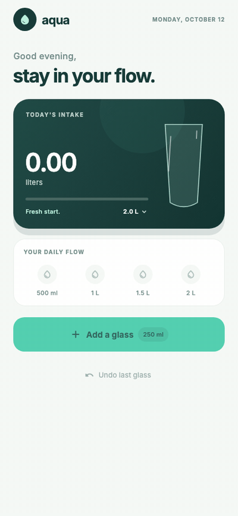
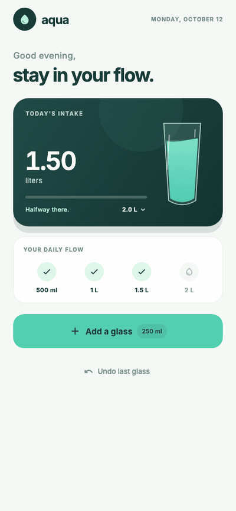

# aqua

<p align="center">
  <strong>A little water goes a long way.</strong><br>
  A calm, one-tap hydration tracker for iOS and Android.
</p>

<p align="center">
  
  &nbsp;&nbsp;
  
</p>

<p align="center">
  <sub>Log a glass in one tap</sub>
  &nbsp;&nbsp;&nbsp;&nbsp;&nbsp;&nbsp;&nbsp;&nbsp;&nbsp;&nbsp;&nbsp;&nbsp;&nbsp;&nbsp;
  <sub>Make the daily goal yours</sub>
</p>

## What it does

**aqua** makes daily hydration easy to see and even easier to track. Tap **Add
a glass** whenever you finish a drink: your total, animated glass, progress
bar, and milestones update together.

- **One-tap logging:** every glass adds 250 ml; undo the last glass if you
  tapped by mistake.
- **A goal that fits you:** tap the goal in the intake card to cycle through
  daily targets from 1.5 to 3 litres.
- **A clear daily picture:** see your total at a glance, watch the glass fill,
  and check off four progress milestones.
- **Private by design:** today's amount and goal are saved on your device.
  Daily intake resets automatically when the date changes; nothing is sent to
  a server.
- **Made for phones:** a responsive Flutter interface with a soft animated
  waterline, designed for iOS and Android.

```sh
flutter test --update-goldens tool/capture_demo_test.dart

ffmpeg -y -framerate 1 -pattern_type glob \
  -i 'assets/gif/0[0-3]-*.png' \
  -filter_complex '[0:v]fps=1,scale=400:-1:flags=lanczos,split[a][b];[a]palettegen=max_colors=128[p];[b][p]paletteuse=dither=bayer:bayer_scale=4' \
  -loop 0 assets/gif/water-progress.gif

ffmpeg -y -framerate 1 -pattern_type glob \
  -i 'assets/gif/0[45]-*.png' \
  -filter_complex '[0:v]fps=1,scale=400:-1:flags=lanczos,split[a][b];[a]palettegen=max_colors=128[p];[b][p]paletteuse=dither=bayer:bayer_scale=4' \
  -loop 0 assets/gif/daily-goal.gif
```

## Project structure

```text
lib/
  main.dart                 App UI, water-glass animation, and local tracking
test/
  widget_test.dart          Hydration interaction and persistence tests
tool/
  capture_demo_test.dart    Captures the README demonstration frames
assets/fonts/
  Inter-Variable.ttf        Inter typeface (SIL Open Font License)
  OFL.txt                   Inter font license
assets/gif/
  *.png                    Flutter golden frames used to build the GIFs
  water-progress.gif        Logging glasses of water
  daily-goal.gif            Updating the daily goal
```
